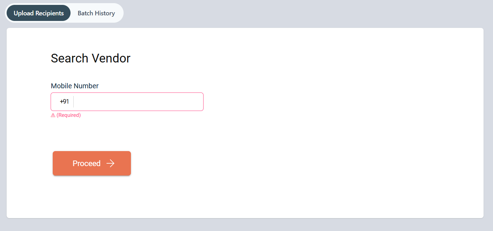
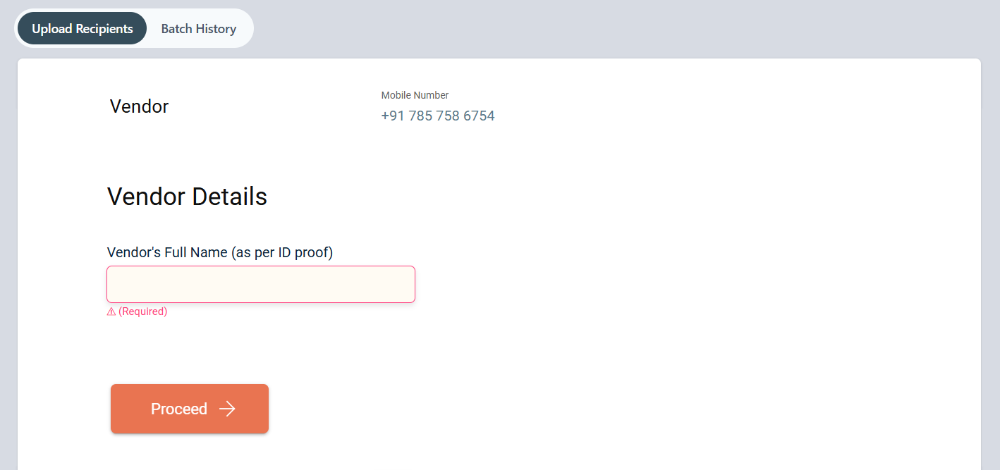
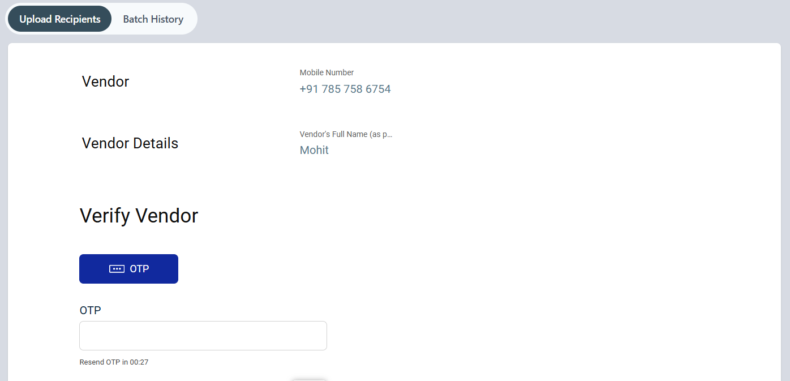
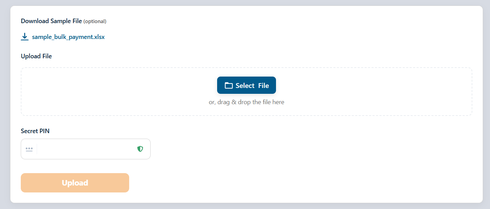
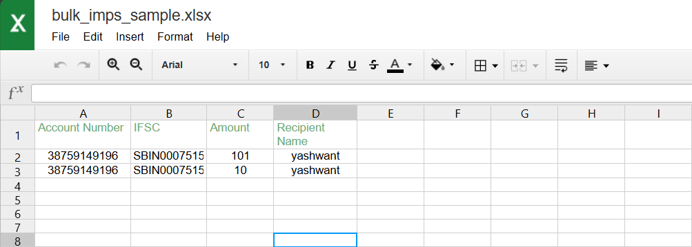
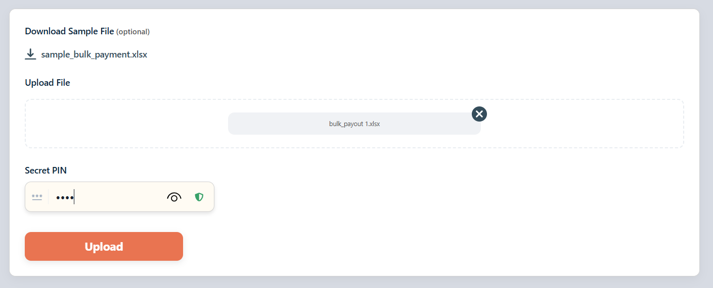
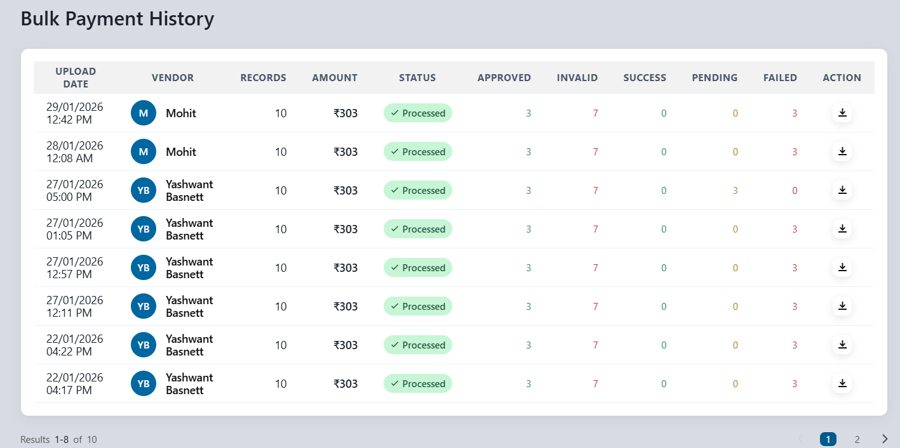
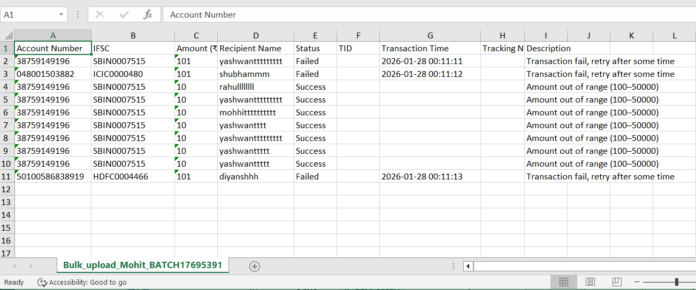

## What is Bulk Payments?

Bulk Payments is a feature that allows agents to process multiple payments simultaneously to their vendors. Instead of processing individual transactions one by one, agents can upload a file containing multiple recipient details and execute all payments in a single batch.

## How to do Bulk Payments?

### Step 1: Search for the vendor

- Navigate to the Bulk Payments section from the main menu.
- Enter the vendor's mobile number in the "Mobile Number" field.
- Click the **Proceed** button to move to the next screen.

### Step 2: For a new vendor

- **Next two screens is for new vendors only**

#### Step 2.a Enter vendor details

- Enter the vendor's name exactly as it appears on their ID proof.
- Click the **Proceed** button to continue.

#### Step 2.b: Verify vendor with OTP

- The vendor will receive the OTP on their registered mobile number.
- Ask the vendor for the OTP and enter it in the "OTP" field.
- Click the **Proceed** button to verify and continue.

### Step 3: Download and Update the Recipient Sample File

- you will download the **sample_bulk_payment.xlsx** file.
- Delete the already present sample entries, and enter the new recipient details in their place, strictly following the defined structure and columns.

#### File structure

The Excel file will contain exactly 4 columns in the following order:

1. **Account Number** - Recipient's bank account number
2. **IFSC Code** - Bank IFSC code
3. **Amount** - Transfer amount in rupees
4. **Name** - Recipient's full name

##### Amount validation

- The amount must be **more than ₹100** and **less than equal to ₹49998** for the transaction to succeed.
- Amounts ending with **00 or 99** will not be processed.

### Step 4: Upload the recipients file

- On the same screen, scroll down to find the file upload section.
- Click the **Select File** button, or drag and drop the Excel file into the designated area.
- In the "Secret PIN" field, enter your agent Secret PIN for authentication.
- Click the **Upload** button to submit the file.

### Step 5: Monitor batch processing status

- After uploading, you will see **Batch History** tab.
- The uploaded batch will appear at the top of the "Bulk Payment History" table.
- The status will show as **PROCESSING** (e.g., "PROCESSING 07/10" means 7 out of 10 records have been processed).
- The file will remain in PROCESSING status until all transactions are completed.
- Once processed, the status will change to **PROCESSED** with a green checkmark.

### Step 6: Download and check transaction results

- In the Batch History screen, locate the batch you want to review.
- Click the download button (↓) in the "ACTION" column adjacent to the uploaded batch.
- The result file will download in Excel format with the name: "Bulk_upload_[vendorName]_BATCH[BatchNumber].xlsx"

#### Understanding the result file

The downloaded file contains the following columns:

| Field Name | Description |
|------------|-------------|
| Account Number | Recipient's bank account number |
| IFSC | Bank IFSC code |
| Amount (₹) | Transfer amount |
| Recipient Name | Full name of the recipient |
| Status | Shows "Success" or "Failed" for each transaction |
| TID | Transaction ID for tracking |
| Transaction Time | Timestamp of when the transaction was processed |
| Tracking Number | Unique tracking number for the transfer |
| Description | Detailed reason for transaction success or failure |

- Review the **Status** column to see which transactions succeeded or failed.
- Check the **Description** column for specific reasons why transactions failed (e.g., "fund.transfer.failed", "Amount out of range (100-5000)").
- Use the **TID** and **Tracking Number** for vendor reference and tracking purposes.

## Key Points

- All transfer amounts must be more than ₹100 and less than ₹50000.
- Amounts ending with 00 or 99 will not be processed.
- Use the correct file format with exactly 4 columns: Account Number, IFSC Code, Amount, and Name.
- Enter your Secret PIN carefully when uploading the file.
- Monitor the batch processing status in the Batch History tab.
- Download the result file to check individual transaction statuses and reasons for any failures.
- Keep the result file for vendor reference and record-keeping purposes.
- The vendor's OTP is valid for a limited time - complete the verification promptly.